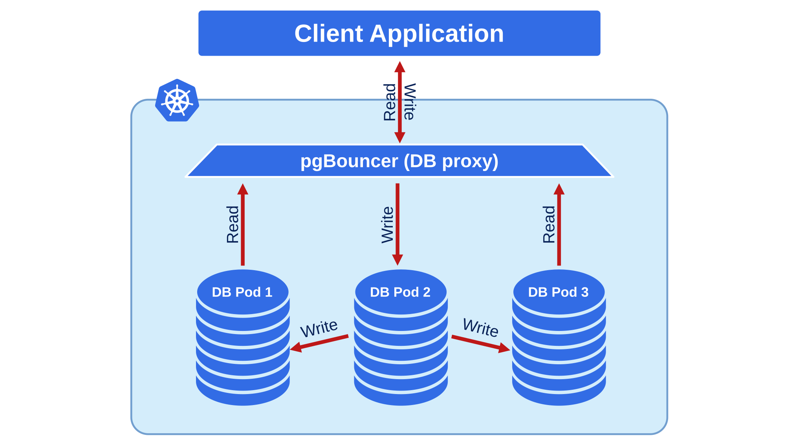
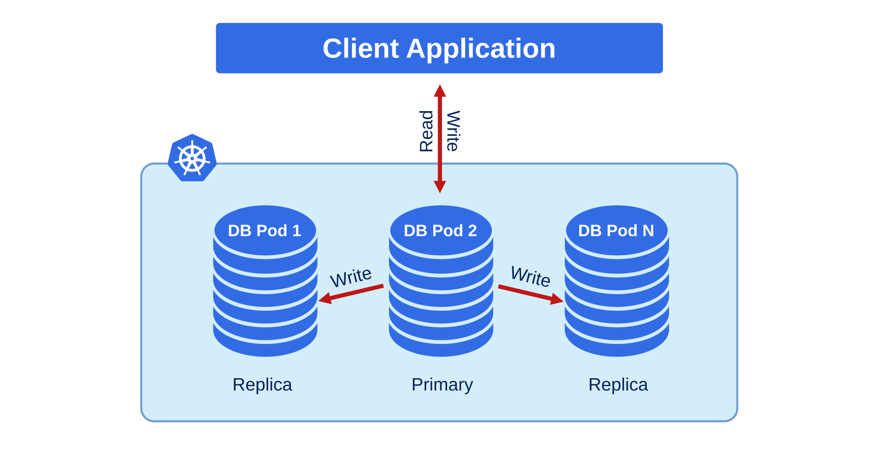

# Exposing cluster

The Operator provides entry points for accessing the database by client applications. The database cluster is exposed with regular Kubernetes [Service objects :octicons-link-external-16:](https://kubernetes.io/docs/concepts/services-networking/service/) configured by the Operator.

This document describes the usage of [Custom Resource manifest options](operator.md) to expose the clusters deployed with the Operator. 

## PgBouncer

We recommend exposing the cluster through PgBouncer, which is enabled by default.



You can disable pgBouncer by setting `proxy.pgBouncer.replicas` to 0.

The following example deploys two pgBouncer nodes exposed through a LoadBalancer Service object:

```yaml
proxy:
  pgBouncer:
    replicas: 2
    image: docker.io/percona/percona-pgbouncer:{{pgbouncerrecommended}}
    expose:
      type: LoadBalancer
```

The Service will be called `<clusterName>-pgbouncer`:

```bash
kubectl get service
```

???+ example "Expected output"

    ``` {.text .no-copy}
    NAME                 TYPE           CLUSTER-IP     EXTERNAL-IP     PORT(S)          AGE
    ...
    cluster1-pgbouncer   LoadBalancer   10.88.8.48     34.133.38.186   5432:30601/TCP   20m
    ...
    ```

You can connect to the database using the External IP of the load balancer and
port `5432`.

If your application runs inside the Kubernetes cluster as well, you might want to
use the Cluster IP Service type in `proxy.pgBouncer.expose.type`, which is the
default. In this case to connect to the database use the internal domain name -
`cluster1-pgbouncer.<namespace>.svc.cluster.local`.

## Exposing the cluster without `pgBouncer`

You can connect to the cluster without a proxy.



The Operator creates two Services that point to the primary: `<clusterName>-primary` and `<clusterName>-ha`. List the Services:

```bash
kubectl get service
```

???+ example "Expected output"

    ``` {.text .no-copy}
    NAME                 TYPE        CLUSTER-IP    EXTERNAL-IP   PORT(S)    AGE
    ...
    cluster1-ha          ClusterIP   10.88.8.121   <none>        5432/TCP   115s
    ...
    cluster1-primary     ClusterIP   None          <none>        5432/TCP   115s
    cluster1-replicas    ClusterIP   10.88.8.115   <none>        5432/TCP   2m16s
    ```

Both Services resolve to the active primary. After a failover, both follow the new primary automatically. Each one serves a different connection scenario:

* `cluster1-primary` is a headless Service for clients inside the Kubernetes cluster. The cluster's TLS certificate includes its name, so use it for clients that verify the server's TLS identity by hostname. You can't expose this Service outside the Kubernetes cluster. The `expose.type` option doesn't change it.
* `cluster1-ha` is the Service that Patroni manages for leader election. The cluster's TLS certificate doesn't include its name. It's the only Service that honors `expose.type`, so use it to reach the primary from outside the Kubernetes cluster without pgBouncer.

To send read requests to PostgreSQL replica instances, use the `cluster1-replicas` Service. Set its type with [`exposeReplicas.type`](operator.md#exposereplicastype).
Reads through this Service bypass pgBouncer. To pool them, see [Configure separate read and write pools](#configure-separate-read-and-write-pools).

For a summary of every Service the Operator creates, see [Services that clients connect to](architecture.md#services-that-clients-connect-to).

To change the type of the `cluster1-ha` Service, use [`expose.type`](operator.md#exposetype) in the Custom Resource manifest. This option doesn't affect `cluster1-primary`.
For example, the following manifest exposes `cluster1-ha` through a load
balancer:

```yaml
spec:
...
  expose:
    type: LoadBalancer
```

## Configure separate read and write pools

By default, pgBouncer pools every connection to the primary. The `<cluster>-replicas` Service reaches the standbys, and those connections skip pgBouncer.

You can configure separate read and write pools so that pgBouncer chooses the PostgreSQL server from the database name in the client connection string. Set that mapping in the `[databases]` section under [`proxy.pgBouncer.config`](operator.md#proxypgbouncerconfig).

Each entry in the mapping is a key-value pair. The key is the database name the client connects to. The value is the connection pgBouncer opens for that name: `host` and `port` select the Service, and `dbname` selects the database on that Service. When `dbname` is absent, pgBouncer opens the same name the client sent.

The application chooses the pool by using a different database name in the connection string.

The cluster needs at least one standby so the replicas Service has endpoints for the read pool.

The following example uses cluster `cluster1` as the cluster name and database `mydb`.

```yaml
proxy:
  pgBouncer:
    config:
      databases:
        "*": "host=cluster1-primary port=5432"
        mydb: "host=cluster1-primary port=5432"
        mydb_ro: "host=cluster1-replicas port=5432 dbname=mydb"
```

!!! warning

    A `databases` map replaces the list the Operator generates. pgBouncer then accepts only the names in this map. Include the `"*"` entry so every database you do not name still reaches the primary.

The map entries work as follows:

* `"*"` sends any database name you do not list to the `cluster1-primary` Service. Keep this entry.
* `mydb` sends that database to `cluster1-primary`, which follows the current primary.
* `mydb_ro` is the read-only name. The client connects to `mydb_ro`, and pgBouncer opens database `mydb` on the `cluster1-replicas` Service.

pgBouncer verifies the PostgreSQL server name during the TLS handshake. Use the `<cluster>-primary` and `<cluster>-replicas` Services as these hosts. Set `port` to the PostgreSQL port in the cluster spec. The default is `5432`.

Add one read-only name for each database that serves pooled reads, and set `dbname` to the real database name. Each name has its own pool, so read traffic and write traffic use separate server connections.

Apply the Custom Resource. The Operator reloads pgBouncer with the new list.

### Use a read-only user for the read pool

Create a read-only user for the read string. The user can't write, even if the read pool connects to the primary.

1. Add the user to the Custom Resource:

    ```yaml
    spec:
      users:
        - name: cluster1-reader
    ```

    The Operator creates the user and the Secret `cluster1-pguser-cluster1-reader` with its password.

2. Connect to `<your_database>` on the primary as the `postgres` user,
    bypassing pgBouncer. See
    [Superuser and pgBouncer](users.md#superuser-and-pgbouncer).
    Make the user read-only:

    ```sql
    ALTER ROLE "cluster1-reader" SET default_transaction_read_only = on;
    GRANT CONNECT ON DATABASE <your_database> TO "cluster1-reader";
    GRANT USAGE ON SCHEMA <your_schema> TO "cluster1-reader";
    GRANT SELECT ON ALL TABLES IN SCHEMA <your_schema> TO "cluster1-reader";
    ALTER DEFAULT PRIVILEGES FOR ROLE <owner> IN SCHEMA <your_schema>
    GRANT SELECT ON TABLES TO "cluster1-reader";
    ```

    `<owner>` is the role that owns the tables. The last statement gives the user `SELECT` on the tables that this role creates later.

3. Use this user in the connection string for read requests. See [Connect clients](#connect-clients) for details.

The `default_transaction_read_only` setting is a default that a session can change. The privileges that you grant are what keep the user from writing.

### Connect clients

Create two connection strings to the pgBouncer Service. For a client inside the cluster, the host is `cluster1-pgbouncer.<namespace>.svc.cluster.local` and the port is `5432`. Use the external address of that Service when the client runs outside the cluster.

The host and the port are the same in both strings. The database name differs. The write string uses the application user. The read string uses the read-only user from the previous section.

* Write string: database `mydb`. Use it for writes and for reads that must see the latest commit.

    Example:

    ```
    host=cluster1-pgbouncer.<namespace>.svc.cluster.local port=5432 dbname=mydb user=<user> password=<password>
    ```

* Read string: database `mydb_ro`. Use it for reads that can run on a standby.

    Example:

    ```
    host=cluster1-pgbouncer.<namespace>.svc.cluster.local port=5432 dbname=mydb_ro user=<read-only-user> password=<read-only-password>
    ```

The user Secret already stores a connection URI for the write path. See [Connect to the PostgreSQL cluster](connect.md). Take the host and the port from that URI. For the read path, set the database name to `mydb_ro` and use the credentials of the read-only user.

The application has to follow these rules:

* Send writes on the write string. The read-only user rejects a write sent on the read string.
* Keep a read on the write string when it must see a transaction that just committed. A standby can lag behind the primary.

!!! warning "Existing connections are not re-routed after a failover"

    pgBouncer looks up the host only when it opens a server connection. After a switchover or failover, connections that are already open stay on the same PostgreSQL instance. Only connections opened after the change use the new primary and replica targets. See [Known limitation: connections are not re-routed after a failover](#known-limitation-connections-are-not-re-routed-after-a-failover).

## Known limitation: connections are not re-routed after a failover

pgBouncer resolves the host of a pool only when it opens a server connection. The Operator does not check which instance a pool is connected to after that. The `cluster1-primary` and `cluster1-replicas` Services follow role changes, but they affect only new connections. After a switchover or failover, the connections that pgBouncer already holds stay on the same PostgreSQL instance.

If the instance that becomes the primary is the one the read pool is connected to, the following happens:

* Read queries sent on the read string run on the new primary and add load to it.
* Write queries sent on the read string succeed, because the instance is no longer a standby. A standby rejects them. The read-only user from the setup rejects these writes.

The pool corrects itself when pgBouncer closes the server connection and opens a new one. With the default settings, this takes up to an hour: `server_lifetime` is 3600 seconds and `server_idle_timeout` is 600 seconds. In the default `session` pool mode, a server connection stays in use as long as the client stays connected, so it can last longer.

The following options shorten the time that reads run on the new primary. They do not stop those reads.

### Recycle the server connections after a switchover or failover

pgBouncer closes the server connections of a pool when you run `RECONNECT` in its admin console. The next connections resolve `cluster1-replicas` again and reach a standby.

1. Get the password of the admin user `_crunchypgbounceradmin`. The Operator stores it under the `pgbouncer-admin-password` key in the `<clusterName>-pgbouncer` Secret:

    ```bash
    kubectl get secret cluster1-pgbouncer -n <namespace> \
      -o jsonpath='{.data.pgbouncer-admin-password}' | base64 -d
    ```

2. From a Pod that has `psql`, connect to the `pgbouncer` administrative database through the pgBouncer Service:

    ```bash
    psql -h cluster1-pgbouncer -p 5432 -U _crunchypgbounceradmin pgbouncer
    ```

3. Recycle the read pool and wait until pgBouncer closes the connections:

    ```sql
    RECONNECT mydb_ro;
    WAIT_CLOSE mydb_ro;
    ```

In the `session` pool mode, pgBouncer closes a connection only after the client releases it, which is when the client disconnects. Combine this workaround with the `transaction` pool mode from the next workaround, or restart the clients.

### Shorten the time that a connection stays open

Set `server_lifetime` and `pool_mode` for the read pool only. The Operator applies the options to the `mydb_ro` entry and leaves the write pool unchanged:

```yaml
spec:
  proxy:
    pgBouncer:
      config:
        databases:
          "*": "host=cluster1-primary port=5432"
          mydb: "host=cluster1-primary port=5432"
          mydb_ro: "host=cluster1-replicas port=5432 dbname=mydb pool_mode=transaction server_lifetime=60"
```

With `pool_mode=transaction`, pgBouncer releases a server connection after each transaction. With `server_lifetime=60`, pgBouncer closes an unused server connection that is older than 60 seconds. A pool therefore reaches a standby again within about a minute after a role change.

The `transaction` pool mode doesn't keep the session state between transactions. Don't use it if your application relies on `SET`, temporary tables, session-level advisory locks, `LISTEN`, or prepared statements. A short `server_lifetime` also increases the number of new connections to PostgreSQL.

### Verify the read pool

Connect through the read string and run:

```sql
SELECT pg_is_in_recovery();
```

The result `t` means that the pool is connected to a standby. The result `f` means that it is connected to the primary. In this case, recycle the server connections. Run the check again after every switchover or failover.

## Expose a logical replica

A [logical replica](logical-replication.md) has its own Service, `<cluster-name>-lr-<replica-name>`. It is not behind pgBouncer. Set `spec.logicalReplicas[].expose` in the same way as `spec.expose`:

```yaml
spec:
  logicalReplicas:
    - name: analytics
      expose:
        type: LoadBalancer
```

See [`logicalReplicas.expose`](operator.md#logicalreplicasexpose).
