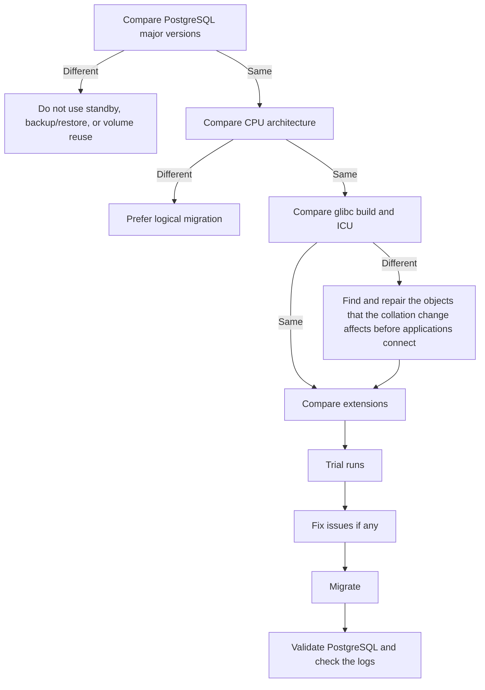

# Pre-migration compatibility checks

!!! important

    Read this before you migrate.
    
Complete these checks **before** you pick a migration method. Verify that source and target environments are compatible. Migration methods such as pgBackRest restore, standby replication or reusing the existing
PostgreSQL data volume all reuse the source PGDATA files. For all these methods, CPU architecture and the PostgreSQL major version must match. If they don't, migrate using `pg_dump` / `pg_restore` instead.

Differences in the operating system, libraries like `glibc`, ICU, or PostgreSQL extensions do not always block reuse of `PGDATA`. But you must take extra steps before or after the migration.

## Decide whether you can reuse the data files

Use this flow to interpret the checks. Then gather the facts in the sections that follow.



## Compare PostgreSQL major versions

The PostgreSQL major version of the source and target database images must match.

Check the source (Crunchy) PostgreSQL version:

```bash
kubectl exec -n <namespace> <source-postgres-pod> -c database -- \
  postgres --version
```

??? example "Sample output"

    ```text
    postgres (PostgreSQL) 18.6
    ```

Check the version in the target Percona image as well. Find tags in [Percona certified images](images.md). If the Percona cluster is not running yet, start a temporary Pod from the target image:

```bash
kubectl run pg-image-check --rm -it --restart=Never \
  --image=<percona-postgres-image> -- \
  postgres --version
```

The major versions must match, for example:

```text
Source: postgres (PostgreSQL) 18.6
Target: postgres (PostgreSQL) 18.6 - Percona Server for PostgreSQL 18.6.1
```

A difference in the minor version is normally supported by PostgreSQL's physical storage format, but the target minor version should be equal to or newer than the source.

Do not reuse `PGDATA` or restore a physical backup directly into a different PostgreSQL major version.

## Compare CPU architecture

Check the architecture of both the source and target PostgreSQL containers:

```bash
kubectl exec -n <namespace> <source-postgres-pod> -c database -- uname -m
kubectl exec -n <namespace> <percona-postgres-pod> -c database -- uname -m
```

??? example "Expected output"

    ```text
    x86_64
    ```

    or:

    ```text
    aarch64
    ```

The source and target must use the same architecture.

For example:

```text
x86_64 -> x86_64    OK
ARM64  -> ARM64     OK
x86_64 -> ARM64     Not OK
```

Use `pg_dump` / `pg_restore` when you migrate across incompatible architectures.

## Compare OS, glibc, and ICU

Crunchy and Percona images can ship different operating system releases and different `glibc` builds. A difference changes how PostgreSQL sorts text, while the indexes that you migrate keep the old order. Read the limitation, compare the images, then decide how to migrate.

### Understand the glibc collation limitation

--8<-- "glibc-collation-limitation.txt"

### Check operating system and glibc

Run these commands against the source Crunchy Pod. Repeat them against the target Percona image.

--8<-- "check-os-glibc.txt"

### Assess the collation risk

Run the queries against the source Crunchy cluster.

--8<-- "collation-assess.txt"

### Decide what to do if the libraries differ

If the assessment shows that no locale you use changed, continue with the next checks.

If a locale you use changed, or you can't confirm that it didn't, all three migration methods carry the risk. Each of them reuses the indexes that the Crunchy image built. Before you point any application to the new cluster, [repair the affected objects](#repair-the-affected-objects).
  
!!! important

    Rehearse the find and repair steps in every trial run, so that you know what the checks find in your data and how long the repair takes. Repeat them during the production cutover.

Plan downtime for the repair. Duplicate keys and rows that violate a constraint need a decision from you about which data to keep.

When to run the steps depends on the migration method:

| Migration method | When to repair |
| ---------------- | -------------- |
| Standby cluster | After you promote the standby. A standby is read-only and can't repair objects, so don't run application queries that rely on text indexes against it. The repair adds to the cutover downtime. |
| Backup and restore | After the restore completes and before you point applications to the new cluster |
| Reusing data volumes | After the Percona cluster starts and before you point applications to it |

### Repair the affected objects

Run these steps on the primary of the Percona cluster. For when to run them, see the table in [Decide what to do if the libraries differ](#decide-what-to-do-if-the-libraries-differ).

--8<-- "collation.txt"

## Compare extensions

pgBackRest restores initialize the new cluster from a physical copy of the Crunchy cluster's data, while volume reuse starts it on the original data directory. In all three cases, the migrated data includes the `pg_extension` catalog, so PostgreSQL retains a record of installed extensions and the objects those extensions created.

The Operator does not read that catalog and copy the Crunchy settings. It applies the extension settings from the `PerconaPGCluster` manifest. 

Before you apply the manifest that creates the Percona cluster, set the extension fields there to match what the source database actually uses. 

### Record extensions on the source

Record the extension name and version in every application database before you migrate.

--8<-- "pg-extensions-list.txt"

Record the libraries PostgreSQL loads at startup:

```sql
SHOW shared_preload_libraries;
```

### Enable built-in extensions

Percona Distribution for PostgreSQL ships a defined set of extensions. Their versions can differ from the Crunchy image. Compare your list with the [extensions shipped with Percona Distribution for PostgreSQL](https://docs.percona.com/postgresql/latest/extensions.html).

These built-in extensions use the following defaults:

| PostgreSQL extension | `spec.extensions` field | Enabled |
| -------------------- | ----------------------- | ------- |
| `vector` | `pgvector` | `false` |
| `pg_stat_statements` | `pg_stat_statements` | `false` |
| `pg_stat_monitor` | `pg_stat_monitor` | `false` |
| `pg_repack` | `pg_repack` | `false` |
| `pgaudit` | `pg_audit` | `true` |
| `pg_cron` | `pg_cron` | `false` | 

Match the spec to the extensions the source database uses. See [Built-in extensions](custom-extensions.md#built-in-extensions) for the full list.

!!! warning

      **Enable every built-in extension you are migrating in the manifest that creates the cluster.** The Operator drops a built-in extension that stays disabled. If anything still depends on such disabled extension, the drop fails silently: the cluster still reports `ready`, nothing in its status flags the failure, and the Operator retries the same drop on every reconcile, logging an "Unable to disable ..." event each time. You won't get a clear error telling you to go fix it — the manifest has to be right going in.
      

On Operator 3.0.0, set the flag under `extensions.builtin`. Starting with version 3.1.0, set `extensions.<name>.enabled`. During the transition, `extensions.builtin` still works. If both forms are set, `extensions.builtin` takes precedence.

The following examples show `pgvector` configuration:

=== "Operator version 3.0.0"

    ```yaml
    spec:
      extensions:
        builtin:
          pgvector: true
    ```

=== "Operator version 3.1.0"

    ```yaml
    spec:
      extensions:
        pgvector:
          enabled: true
    ```

When you enable a built-in extension that is already installed, the Operator runs `ALTER EXTENSION ... UPDATE`. Compare the extension's version on the source cluster with the version available in the target cluster's image. Test that update in a trial run and check the application before you migrate production.

### PostGIS

PostGIS is a separate case. If the source cluster uses PostGIS, deploy the target with the [PostGIS image](postgis.md).

A database upgrade does not update PostGIS. Run `SELECT PostGIS_Extensions_Upgrade();` in each database that uses PostGIS. See [Upgrade the PostGIS extension](update-extensions.md#upgrade-postgis-extension). 

### Install extensions that are not in the Percona image

Compare your `pg_extension` output with the Percona image you deploy. If you use extensions that are not in the Percona image, add them as [custom extensions](custom-extensions.md#add-custom-extensions).

An extension that ships a native library needs that library to be present in the target PostgreSQL installation. If the extension requires startup preloading, also list its preload library in `shared_preload_libraries`; a `pg_extension` catalog row does not provide either requirement.

For a preload library the Operator does not append, set `patroni.dynamicConfiguration.postgresql.parameters.shared_preload_libraries`. Include only those libraries. The Operator appends the libraries for built-in extensions you enable. See [Extension parameters](immutable-options.md#extension-parameters).

### Match set_user and pg_cron to the Operator version

`set_user` and `pg_cron` are custom extensions on Operator 3.0.0. Starting with version 3.1.0, they are built-in extensions and default to `disabled`. The Operator drops each one that stays disabled.

| Extension | Operator 3.0.0 | Operator 3.1.0 and later |
| --------- | -------------- | ------------------------ |
| `set_user` | Add it under `extensions.custom`. Include `set_user` in `shared_preload_libraries`. | Set `extensions.set_user.enabled` to `true`. The Operator appends `set_user` to `shared_preload_libraries`. |
| `pg_cron` | Add it under `extensions.custom`. Include `pg_cron` in `shared_preload_libraries`. | Set `extensions.pg_cron.enabled` to `true`. The Operator appends `pg_cron` to `shared_preload_libraries` and sets `cron.database_name` to `postgres`. |

On Operator 3.0.0, first package and configure both as custom extensions by following [Add custom extensions](custom-extensions.md#add-custom-extensions). After you configure `extensions.image` and `extensions.storage`, add these entries:

```yaml
spec:
  extensions:
    custom:
      - name: set_user
        version: "<set_user-version>"
      - name: pg_cron
        version: "<pg_cron-version>"
  patroni:
    dynamicConfiguration:
      postgresql:
        parameters:
          shared_preload_libraries: "set_user,pg_cron"
```

Starting with version 3.1.0, enable the built-in flags. The Operator appends `set_user` and `pg_cron` to `shared_preload_libraries`. Set that parameter for any other preload libraries:

```yaml
spec:
  extensions:
    set_user:
      enabled: true
    pg_cron:
      enabled: true
```

!!! warning

    Starting with version 3.1.0, use the built-in flags for a new cluster. Removing `set_user` or `pg_cron` from `extensions.custom` without setting its `enabled` flag to `true` in the same apply deletes the extension.

If the source cluster schedules `pg_cron` jobs in a database other
than `postgres`, those jobs stop running after migration. The
Operator sets `cron.database_name` to `postgres`.

On the source cluster, check the current value:

```sql
SHOW cron.database_name;
```

When the result is `postgres`, the existing jobs keep running. When it is another database, `pg_cron` stops reading the job list stored there. In that database, list the jobs:

```sql
SELECT jobname, schedule, command, database FROM cron.job;
```

After the Percona cluster is running, connect to the `postgres` database and create each job again with `cron.schedule_in_database`. The last argument is the database where the command runs (`appdb` in this example):

```sql
SELECT cron.schedule_in_database('weekly-vacuum', '0 4 * * 0', 'VACUUM', 'appdb');
```

You can also [add custom extensions](custom-extensions.md#add-custom-extensions) if you need them or if they are missing in Percona images. Evaluate the risk before you add any extension.

After the Percona cluster reports `Ready`, check the database logs. In every database that you recorded earlier, run `\dx` and confirm that each extension is installed at the version you tested.

## Check what else changes after migration

The migration methods in this guide copy the data directory, so the migrated cluster keeps the data itself. The Operator still applies its own naming, defaults, and labels on top of that data. None of this blocks the migration, but missing it causes problems ranging from broken logins to blind monitoring.

### Match passwords for Operator-managed users

The Operator doesn't copy user credentials from Crunchy during migration. It generates a new password for any user it manages and applies it to the database, overwriting the password that migrated with the data. Existing application logins break the moment the Operator reconciles that user.

To keep the Crunchy passwords, do this **before** you create the cluster:

* Copy the `password` and `verifier` keys into the `<clusterName>-pguser-<userName>` Secret 
* List every migrated user in `spec.users`. See [Understanding default user management](users.md#understanding-default-user-management) for the naming convention.

### Keep the user schema behavior Crunchy had

Crunchy puts a user's tables in the `public` schema by default. The Operator's `autoCreateUserSchema` defaults to `true` and creates a schema named after the user instead. Set it to `false` in the manifest that creates the cluster if your application expects unqualified table names to resolve to `public`.

### Recreate non-extension Postgres settings

The Operator does not carry over Crunchy's `dynamicConfiguration`. Only `pgaudit` is preloaded by default. If the source cluster set other `postgresql.conf` parameters or preloaded other libraries, add them under `patroni.dynamicConfiguration.postgresql.parameters` and `shared_preload_libraries` the same way you already did for extensions. See [Extension parameters](immutable-options.md#extension-parameters).

### Update labels, Services and anything that reads them

The primary Pod's `postgres-operator.crunchydata.com/role` label changes value from `master` to `primary`, and every Service name follows the new cluster name instead of Crunchy's. Update NetworkPolicies, alert rules, and any script or dashboard that selects on the old label value or Service name.

### Replace monitoring and admin tools

pgMonitor, its `ccp_*` metrics, and its Grafana dashboards don't carry over. Replace them with [Percona Monitoring and Management](monitor-kubernetes.md) or a [`postgres_exporter` sidecar](postgres-exporter.md). 

pgAdmin and OpenTelemetry collection have no equivalent in the Operator. Plan an alternative before cutover if you depend on either.

### Rotate TLS certificates after a standby cutover

[Migrating using a standby cluster](migrate-from-crunchy-standby.md) keeps Crunchy-issued certificates for mutual TLS during replication. Replace them with the Operator-issued or your own certificates after cutover, so the new primary doesn't keep trusting Crunchy's CA indefinitely.

## Before you cut over

Perform at least **three successful trial runs** in a comparable test environment and validate the application after each one. The first run usually exposes missing steps, the second confirms the fixes, and the third shows that the procedure is repeatable and the cutover time is predictable. Capture that as a detailed, environment-specific runbook before you migrate production workloads.

After PostgreSQL starts under Percona Operator for PostgreSQL, check the PostgreSQL logs for errors, then confirm that extensions are complete. If the `glibc` builds differ, also confirm that you repaired the affected objects before applications connect.
