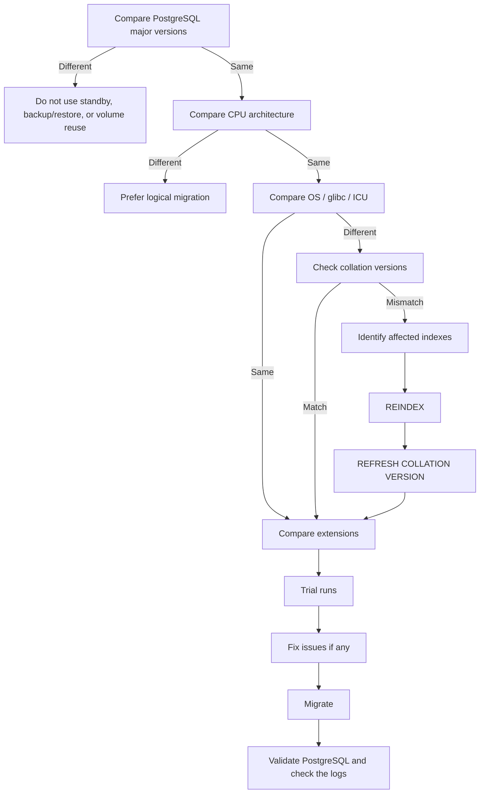

# Pre-migration compatibility checks

!!! important

    Read this before you migrate.
    
Complete these checks **before** you pick a migration method. Verify that source and target environments are compatible. Migration methods such as pgBackRest restore, standby replication or reusing the existing
PostgreSQL data volume all reuse the source PGDATA files. For all these methods, CPU architecture and the PostgreSQL major version must match. If they don't, migrate using `pg_dump` / `pg_restore` instead.

Differences in the operating system, libraries like `glibc`, ICU, or PostgreSQL extensions do not always block reuse of `PGDATA`. But you must take extra steps before or after the migration.

## Decide whether you can reuse the data files

Use this flow to interpret the checks. Then gather the facts in the sections that follow.



## Compare PostgreSQL major versions

The PostgreSQL major version of the source and target database images must match.

Check the source (Crunchy) PostgreSQL version:

```bash
kubectl exec -n <namespace> <source-postgres-pod> -c database -- \
  postgres --version
```

??? example "Sample output"

    ```text
    postgres (PostgreSQL) 18.6
    ```

Check the version in the target Percona image as well. Find tags in [Percona certified images](images.md). If the Percona cluster is not running yet, start a temporary Pod from the target image:

```bash
kubectl run pg-image-check --rm -it --restart=Never \
  --image=<percona-postgres-image> -- \
  postgres --version
```

The major versions must match, for example:

```text
Source: postgres (PostgreSQL) 18.6
Target: postgres (PostgreSQL) 18.6 - Percona Server for PostgreSQL 18.6.1
```

A difference in the minor version is normally supported by PostgreSQL's physical storage format, but the target minor version should be equal to or newer than the source.

Do not reuse `PGDATA` or restore a physical backup directly into a different PostgreSQL major version.

## Compare CPU architecture

Check the architecture of both the source and target PostgreSQL containers:

```bash
kubectl exec -n <namespace> <source-postgres-pod> -c database -- uname -m
kubectl exec -n <namespace> <percona-postgres-pod> -c database -- uname -m
```

??? example "Expected output"

    ```text
    x86_64
    ```

    or:

    ```text
    aarch64
    ```

The source and target must use the same architecture.

For example:

```text
x86_64 -> x86_64    OK
ARM64  -> ARM64     OK
x86_64 -> ARM64     Not OK
```

Use `pg_dump` / `pg_restore` when you migrate across incompatible architectures.

## Compare OS, glibc, and ICU

Run these commands against the source Crunchy pod. Repeat them against the target Percona image (use a temporary Pod if the cluster is not running yet).

### Check operating system 

--8<-- "check-os-glibc.txt"

--8<-- "glibc-versions.txt"

If the Crunchy image is UBI 8 and you use the default Percona image (UBI 9), you will see a `glibc` change:

```text
Source:
  UBI 8
  glibc 2.28

Target:
  UBI 9
  glibc 2.34
```

A different `glibc` version does not by itself make the PostgreSQL data directory incompatible. `glibc` provides locale and collation rules that PostgreSQL uses. A change in these rules can make existing collation-dependent indexes inconsistent with the target operating system. See [Locale data changes](https://wiki.postgresql.org/wiki/Locale_data_changes) in the PostgreSQL wiki.

### Check ICU library version

PostgreSQL may also use ICU for collations. Check the locale provider in each database:

```sql
  SELECT datname, datlocprovider, datcollversion FROM pg_database;
```

??? example "Sample output"
    
    ```text
      datname  | datlocprovider | datcollversion
    -----------+----------------+----------------
    postgres  | c              | 2.34
    template1 | c              | 2.34
    template0 | c              |
    cluster1  | c              | 2.34
    (4 rows)
    ```

`c` is libc (`glibc`). `i` is ICU. If the provider is `i` and the source and target images ship different ICU libraries, treat that the same as a `glibc` change.

If `glibc` or ICU differs, run the collation checks **after** PostgreSQL starts on the target image. You can run the index scan on the source cluster beforehand to estimate the work.

[Connect to PostgreSQL](connect.md) with the privileges of the superuser or the database owner and run the following query:

```sql
SELECT DISTINCT
    indrelid::regclass::text,
    indexrelid::regclass::text,
    collname,
    pg_get_indexdef(indexrelid)
FROM (
    SELECT
        indexrelid,
        indrelid,
        indcollation[i] coll
    FROM
        pg_index,
        generate_subscripts(indcollation, 1) g(i)
) s
JOIN pg_collation c ON coll = c.oid
WHERE
    collprovider IN ('d', 'c')
    AND collname NOT IN ('C', 'POSIX');
```

Check indexes that rely on collations other than `C` or `POSIX` and whose collations were provided by the operating system (`c`) or dynamic libraries (`d`). If you see affected indexes, find the databases whose collation
version changed:

```sql
SELECT datname, datlocprovider, datcollate, datcollversion
FROM pg_database;
```

??? example "Sample output"

    ```{.text .no-copy}
    datname   | datlocprovider | datcollate  | datcollversion
    ----------+----------------+-------------+----------------
    postgres  | c              | en_US.utf-8 | 2.28
    template1 | c              | en_US.utf-8 | 2.28
    template0 | c              | en_US.utf-8 |
    cluster1  | c              | en_US.utf-8 | 2.28
    ```


## Compare extensions

pgBackRest restore and standby replication initialize the new cluster from a physical copy of the Crunchy cluster's data, while volume reuse starts it on the original data directory. In all three cases, the migrated data includes the `pg_extension` catalog, so PostgreSQL retains a record of installed extensions and the objects those extensions created.

The Operator does not read that catalog and copy the Crunchy settings. It applies the extension settings from the `PerconaPGCluster` manifest. 

Before you apply the manifest that creates the Percona cluster, set the extension fields there to match what the source database actually uses. 

### Record extensions on the source

Record the extension name and version in every application database before you migrate.

--8<-- "pg-extensions-list.txt"

Record the libraries PostgreSQL loads at startup:

```sql
SHOW shared_preload_libraries;
```

### Enable built-in extensions

Percona Distribution for PostgreSQL ships a defined set of extensions. Their versions can differ from the Crunchy image. Compare your list with the [extensions shipped with Percona Distribution for PostgreSQL](https://docs.percona.com/postgresql/latest/extensions.html).

These built-in extensions use the following defaults:

| PostgreSQL extension | `spec.extensions` field | Enabled |
| -------------------- | ----------------------- | ------- |
| `vector` | `pgvector` | `false` |
| `pg_stat_statements` | `pg_stat_statements` | `false` |
| `pg_stat_monitor` | `pg_stat_monitor` | `false` |
| `pg_repack` | `pg_repack` | `false` |
| `pgaudit` | `pg_audit` | `true` |

Match the spec to the extensions the source database uses. See [Built-in extensions](custom-extensions.md#built-in-extensions) for the full list.

!!! warning

    The Operator drops a built-in extension that stays disabled. Enable every built-in extension you are migrating in the manifest that creates the cluster. If objects still depend on the extension, the drop fails and the cluster does not reconcile.

On Operator 3.0.0, set the flag under `extensions.builtin`. Starting with version 3.1.0, set `extensions.<name>.enabled`. During the transition, `extensions.builtin` still works. If both forms are set, `extensions.builtin` takes precedence.

The following examples show `pgvector` configuration:

=== "Operator version 3.0.0"

    ```yaml
    spec:
      extensions:
        builtin:
          pgvector: true
    ```

=== "Operator version 3.1.0"

    ```yaml
    spec:
      extensions:
        pgvector:
          enabled: true
    ```

When you enable a built-in extension that is already installed, the Operator runs `ALTER EXTENSION ... UPDATE`. Compare the extension's version on the source cluster with the version available in the target cluster's image. Test that update in a trial run and check the application before you migrate production.

### PostGIS

PostGIS is a separate case. If the source cluster uses PostGIS, deploy the target with the [PostGIS image](postgis.md).

A database upgrade does not update PostGIS. Run `SELECT PostGIS_Extensions_Upgrade();` in each database that uses PostGIS. See [Upgrade the PostGIS extension](update-extensions.md#upgrade-postgis-extension). 

### Install extensions that are not in the Percona image

Compare your `pg_extension` output with the Percona image you deploy. If you use extensions that are not in the Percona image, add them as [custom extensions](custom-extensions.md#add-custom-extensions).

An extension that ships a native library needs that library to be present in the target PostgreSQL installation. If the extension requires startup preloading, also list its preload library in `shared_preload_libraries`; a `pg_extension` catalog row does not provide either requirement.

For a preload library the Operator does not append, set `patroni.dynamicConfiguration.postgresql.parameters.shared_preload_libraries`. Include only those libraries. The Operator appends the libraries for built-in extensions you enable. See [Extension parameters](immutable-options.md#extension-parameters).

### Match set_user and pg_cron to the Operator version

`set_user` and `pg_cron` are custom extensions on Operator 3.0.0. Starting with version 3.1.0, they are built-in extensions and default to `disabled`. The Operator drops each one that stays disabled.

| Extension | Operator 3.0.0 | Operator 3.1.0 and later |
| --------- | -------------- | ------------------------ |
| `set_user` | Add it under `extensions.custom`. Include `set_user` in `shared_preload_libraries`. | Set `extensions.set_user.enabled` to `true`. The Operator appends `set_user` to `shared_preload_libraries`. |
| `pg_cron` | Add it under `extensions.custom`. Include `pg_cron` in `shared_preload_libraries`. | Set `extensions.pg_cron.enabled` to `true`. The Operator appends `pg_cron` to `shared_preload_libraries` and sets `cron.database_name` to `postgres`. |

On Operator 3.0.0, first package and configure both as custom extensions by following [Add custom extensions](custom-extensions.md#add-custom-extensions). After you configure `extensions.image` and `extensions.storage`, add these entries:

```yaml
spec:
  extensions:
    custom:
      - name: set_user
        version: "<set_user-version>"
      - name: pg_cron
        version: "<pg_cron-version>"
  patroni:
    dynamicConfiguration:
      postgresql:
        parameters:
          shared_preload_libraries: "set_user,pg_cron"
```

Starting with version 3.1.0, enable the built-in flags. The Operator appends `set_user` and `pg_cron` to `shared_preload_libraries`. Set that parameter for any other preload libraries:

```yaml
spec:
  extensions:
    set_user:
      enabled: true
    pg_cron:
      enabled: true
```

!!! warning

    Starting with version 3.1.0, use the built-in flags for a new cluster. Removing `set_user` or `pg_cron` from `extensions.custom` without setting its `enabled` flag to `true` in the same apply deletes the extension.

If the source cluster schedules `pg_cron` jobs in a database other than `postgres`, those jobs stop running after migration. The Operator sets `cron.database_name` to `postgres`.

After the Percona cluster reports `Ready`, check the database logs. In every database that you recorded earlier, run `\dx` and confirm that each extension is installed at the version you tested.

## Before you cut over

Perform at least **three successful trial runs** in a comparable test environment and validate the application after each one. The first run usually exposes missing steps, the second confirms the fixes, and the third shows that the procedure is repeatable and the cutover time is predictable. Capture that as a detailed, environment-specific runbook before you migrate production workloads.

After PostgreSQL starts under Percona Operator for PostgreSQL, check the PostgreSQL logs for errors, then confirm that collation rebuilds and extensions are complete.
