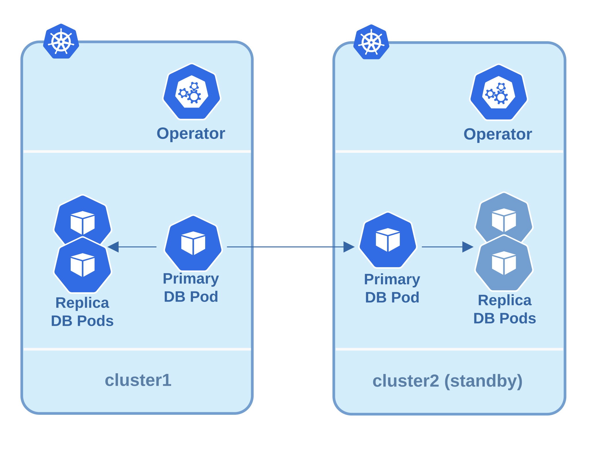

# Standby cluster deployment based on streaming replication

The following diagram explains how the standby based on streaming replication works:



1. This solution describes two Kubernetes clusters in different regions, clouds, data centers or even two namespaces, or running in hybrid mode (on-premises and cloud). One cluster is Main site, and the other is Disaster Recovery site (DR)

2. Each site supposedly includes Percona Operator and for sure includes PostgreSQL cluster.

3. In the DR site the cluster is in Standby mode

4. We set up streaming replication between these two clusters

## Deploy disaster recovery for PostgreSQL on Kubernetes

### Configure Main site

1. Deploy the Operator [using your favorite method](System-Requirements.md#installation-guidelines).

2. The Main cluster needs to expose it, so that standby can connect to the primary PostgreSQL instance. To expose the primary PostgreSQL instance, use the `spec.expose` section:

    ```yaml
    spec:
      ...
      expose:
        type: ClusterIP
    ```

    Use here a Service type of your choice. For example, `ClusterIP` is sufficient for two clusters in different Kubernetes namespaces.

3. Once configured, apply the custom resource:

    ```bash
    kubectl apply -f deploy/cr.yaml -n main-pg
    ```

    ??? example "Expected output"

        ```{.bash .no-copy}
        perconapgcluster.pg.percona.com/standby created
        ```

    The service that you should use for connecting to standby is called <clustername>-ha (main-ha in my case):

    ```text
    main-ha          ClusterIP   10.118.227.214   <none>        5432/TCP   163m
    ```

### Configure DR site

To get the replication working, the Standby cluster would need to authenticate with the Main one. To get there, both clusters must have certificates signed by the same certificate authority (CA). Default replication user `_crunchyrepl` will be used.

To ensure authentication, choose one of these options for the server certificate:

* **One shared server certificate.** Create one server certificate that contains the Service names of both sites, and use it on both clusters. Copy the Secrets with the certificates from the Main site to the DR namespace. Reissue the server certificate first, so that it contains the DR names, and apply it to the Main site too. This option needs the fewest certificates.
* **A server certificate for each site.** Create a separate server certificate for the DR site, with the names of the DR site only, and sign it with the same CA that signed the certificates of the Main site. The Main site keeps its server certificate.

Follow these rules when you generate the certificates:

1. Certificates for both Main and Standby clusters must be signed by the same CA. The replication user needs this to authenticate with the Main site, and the same CA lets each site trust the other after a [role swap](standby-switchover.md).
2. `customReplicationTLSSecret` must have a Common Name (CN) setting that matches `_crunchyrepl`, which is a default replication user.
3. The server certificate of each site must contain the names of its own `<cluster>-primary` and `<cluster>-replicas` Services, each as `<name>`, `<name>.<namespace>`, `<name>.<namespace>.svc` and `<name>.<namespace>.svc.cluster.local`. A shared certificate contains the names of both sites. pgBouncer checks the `<cluster>-primary` name of its own cluster. If the certificate has only the names of the Main site, pgBouncer on the DR site can't connect to PostgreSQL after a promotion, and its log shows `name 'dr-primary' not present in server certificate`.

Create the Secrets in the namespace where the DR cluster is going to run, and reference them under `spec.secrets`:

```yaml
spec:
  secrets:
    customTLSSecret:
      name: dr-cluster-cert
    customReplicationTLSSecret:
      name: dr-replication-cert
```

You can find more about certificates in the [TLS doc](TLS.md).

Apart from setting certificates correctly, you should also set standby configuration.

```yaml
  standby:
    enabled: true
    host: main-ha.main-pg.svc
    maxAcceptableLag: 10Mi  # optional: enables replication lag detection
```

* `standby.enabled` controls if it is a standby cluster or not
* `standby.host` must point to the primary node of a Main cluster. In this example it is a `main-ha` Service in another namespace.
* `standby.maxAcceptableLag` (optional) enables replication lag detection. When the WAL lag exceeds this value, the standby primary pod is marked as unready, the cluster goes into `initializing` state, and a `StandbyLagging` condition is set in the status.

Deploy the standby cluster by applying the manifest:

```bash
kubectl apply -f dr-cr.yaml -n dr-pg
```

??? example "Expected output"

    ```{.bash .no-copy}
    perconapgcluster.pg.percona.com/standby created
    ```

Once both clusters are up, you can verify that replication is working.

1. Insert some data into Main cluster
2. Connect to the DR cluster

To connect to the DR cluster, use the credentials that you used to connect to Main. This also verifies that the connection is working. You should see whatever data you have in the Main cluster in the Disaster Recovery.

### Copy the user and pgBouncer passwords

Copy the user passwords and the pgBouncer password from the Main site to the DR site, so that applications and pgBouncer can log in after you promote the DR cluster. Follow [Prepare the user passwords](standby-failover.md#prepare-the-user-passwords).

## Next steps

Because the certificates of both sites are signed by the same CA, you can later [swap their roles](standby-switchover.md). The Main site then follows the DR site without a rebuild.


